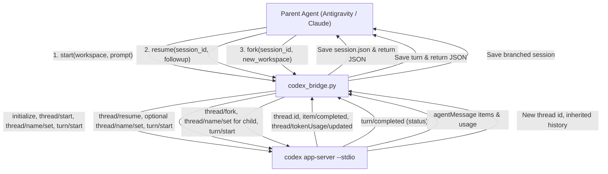

# Codex Bridge Lifecycle & Cross-Agent Best Practices

This document specifies how an orchestrator agent (such as Antigravity CLI or Claude Code) interfaces with OpenAI Codex as an external subagent.

## 1. Core Principles

1. **Explicit Session Identity:** Each conversation is bound to a `bridge_session_id` (managed by the bridge) and mapped to Codex's internal `codex_thread_id`. Never rely on `--last` in automated multi-agent environments.
2. **Dedicated Workspaces:** For parallel coding or separate feature tasks, operate in dedicated Git worktrees or clones. Filesystem and git commits are the true source of truth, while Codex threads provide conversational context.
3. **Structured Non-Interactive I/O:**
   - Each turn runs through `codex app-server --stdio` (JSON-RPC, one JSON object per line), the same protocol the Codex desktop app uses. Codex itself creates and persists the thread, so bridge sessions appear in the desktop app with full history and the bridge never edits Codex's private state.
   - Raw protocol messages are saved to `events.jsonl`; the final reply is the last `agentMessage` item of the turn.
   - A turn is complete when the `turn/completed` notification arrives, not when the process exits. On timeout the bridge sends `turn/interrupt` and keeps the thread id for recovery.
4. **Approval & Sandbox Policy:**
   - Non-interactive automation uses `approvalPolicy: never`. Any server-initiated approval or tool request is refused and reported as an error.
   - Sandbox modes: `read-only` (safe analysis), `workspace-write` (in-repo modifications), or `danger-full-access` (when commands need broader system tools).
5. **Session Reuse & Single-Thread Collaboration:**
   - The orchestrating agent should prefer reusing the same Codex bridge session across turns (via `resume`) throughout a single agent task or conversation.
   - Reusing a single session ensures Codex retains accumulated context, architectural decisions, and file changes without redundant re-explaining.
   - If `thread/resume` fails with an "active writer conflict" (which occurs when the thread is simultaneously opened by the Codex Desktop GUI), `fork` serves as an immediate fallback to branch a new writable thread from the existing context.

---

## 2. Session Lifecycle Flowchart



The bridge uses `thread/name/set` before `turn/start` to persist the `[codex-bridge]` title in Codex Desktop and Codex thread listings. `start` and `fork` take an optional `--title <TITLE>`. Their default uses a short excerpt of the initial or fork prompt, preferably its `Objective:` line. With no usable excerpt, the names are `[codex-bridge] New session` and `[codex-bridge] Forked session`.

`resume --title <TITLE>` renames the existing thread with the same prefix. `resume` without `--title` keeps its current name, so older sessions can be tagged by resuming with an explicit title. If the naming request fails or exceeds its five-second timeout, the bridge emits a warning on standard error and proceeds with the turn.

### Agent-session marker and language

- The first turn of every `start` session is automatically prefixed with a `[codex-bridge agent session]` marker line. It tells Codex the thread was started programmatically by an AI agent (not a human) and asks it to reply in English. Codex recognizes this pattern via `~/.codex/AGENTS.md`, which declares any thread opening with this marker an agent-to-agent session. The marker is stored as part of turn 1's prompt in `session.json`.
- All prompts sent through the bridge must be written in English, regardless of the language of the surrounding user conversation; Codex replies are likewise expected in English.

---

## 3. Delegation Prompt Template

When handing off a task to Codex, provide a bounded scope:

```text
Objective: [Concise description of the task]
Workspace: [Absolute directory path]
Constraints:
- Only modify files in [target directory]
- Do not commit, push, or modify configuration outside the target
- Run test command [e.g. pytest / go test] to verify
Acceptance Criteria:
- All new tests pass
- Report back changed files and test output
If blocked:
- Stop and explain the blocker; do not invent missing APIs or requirements
```

---

## 4. State Storage

All sessions managed by `codex_bridge.py` are saved in:
`~/.codex-bridge/sessions/<bridge_session_id>/`
- `session.json`: Complete session metadata, workspace, model, and history of turns.
- `runs/turn_<n>_<timestamp>/`:
  - `events.jsonl`: Every JSON-RPC message received from `codex app-server` during the turn (responses and notifications).
  - `stderr.log`: App-server stderr, plus any bridge-side error such as a refused approval request or a timeout interrupt.
  - `last_message.txt`: Clean final assistant response (the last `agentMessage` item of the turn).

The bridge does not write to `~/.codex`. Codex owns the thread records there, and `codex_thread_id` in `session.json` is the key that links the two stores.
